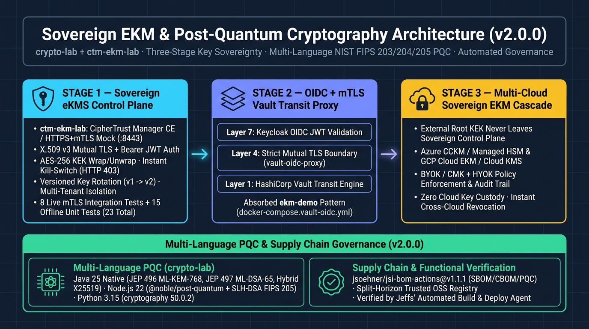
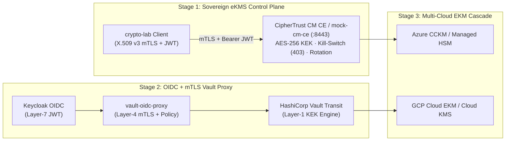

# CTM EKM Lab — Sovereign EKM Control Plane (`v2.0.0`)

Companion infrastructure and bootstrap repository for running **Thales CipherTrust Manager Community Edition (CM CE)**, the **Stage 2 Vault Transit + Keycloak OIDC mTLS Proxy**, and **Stage 3 Multi-Cloud Sovereign EKM** integrations connected to [crypto-lab](https://github.com/jsoehner/crypto-lab) (`v2.0.0`).

> **Latest Verification (`2026-11-20` · `v2.0.0`):** Verified end-to-end (shell/Python syntax, Docker Compose YAML validation, live HTTPS + X.509 v3 mTLS `mock-cm-ce/server.py`, `curl` API probes, and all 8 live `crypto-lab` CTM integration tests) by **Jeffs' Automated build and deploy agent** — see [`docs/BUILD_VERIFICATION.md`](docs/BUILD_VERIFICATION.md).



---

## Why a Separate Repository?

CipherTrust Manager Community Edition is distributed as a full virtual appliance (OVA/QCOW2/VHD) requiring ~8 GB RAM and portal-gated download. Separating appliance deployment, Vault + Keycloak OIDC Compose stacks, and local lab PKI from `crypto-lab` keeps the multi-language cryptographic reference repo lightweight and CI-friendly.

---

## Three-Stage Sovereign EKM Flow



---

## Quickstart

### 1. Deploy CipherTrust Manager (Real Appliance OR Local Lab Mock)

**Option A — Real CipherTrust Manager Community Edition Appliance:**
1. Download the **CipherTrust Manager Community Edition** appliance (OVA or QCOW2) from the Thales Customer Support / Community portal.
2. Boot the appliance with at least **2 vCPUs, 8 GB RAM, 100 GB disk** and complete the initial admin password + community license activation.
3. Export the appliance URL:
   ```bash
   export CIPHERTRUST_URL="https://<appliance-ip-or-fqdn>"
   export CIPHERTRUST_USER="admin"
   export CIPHERTRUST_PASSWORD="<your-bootstrap-password>"
   ```

**Option B — Local HTTPS + mTLS Lab Server (Immediate Testing Without Appliance):**
```bash
bash scripts/generate_mtls_certs.sh
python3 mock-cm-ce/server.py &
export CIPHERTRUST_URL="https://127.0.0.1:8443"
export CIPHERTRUST_USER="admin"
export CIPHERTRUST_PASSWORD="lab-bootstrap-pass"
```
*(Or run via Docker/Podman with `docker compose up -d`.)*

### 2. Generate Lab mTLS Certificates
```bash
bash scripts/generate_mtls_certs.sh
```
This creates a local lab CA and client certificate under `certs/` (git-ignored).

### 3. Bootstrap Key & Client Config
```bash
bash scripts/bootstrap_cm_ce.sh
```
This creates `demo-app-kek` (AES-256) in CipherTrust Manager and writes `.env.ciphertrust` (git-ignored).

### 4. Run `crypto-lab` Against This Instance
From `crypto-lab`:
```bash
set -a && source /home/jsoehner/ctm-ekm-lab/.env.ciphertrust && set +a

# Demo runner automatically detects CIPHERTRUST_URL and runs live EKM encryption
./demo_langs.sh python

# Runs all 15 offline unit tests + 8 live CTM integration tests (23 total)
python3 -m unittest discover -s python -p 'test_*.py' -v
```

### Supported Live Integration Test Cases (`test_ctm_integration.py`)
- **Key Lifecycle & Metadata**: `POST /api/v1/vault/keys2`, `GET /api/v1/vault/keys2/{name}`
- **Live DEK Envelope**: `POST /api/v1/crypto/encrypt` and `/decrypt` over HTTPS + mTLS
- **AAD & Tamper Rejection**: Mismatched AAD (`HTTP 400`) and modified ciphertext (`InvalidTag`)
- **Kill-Switch & Recovery**: `deactivate` (`HTTP 403` blocks decrypt) and `reactivate` (restores decrypt)
- **Key Rotation**: `rotate` increments KEK to `v2` while `v1` envelopes continue to unwrap
- **Multi-Tenant Isolation**: Revoking `ctm-tenant-a` does not affect `ctm-tenant-b`
- **Negative Auth & mTLS**: Invalid credentials/JWT (`HTTP 401`) and missing client cert (`SSLError`)

---

## Cloud EKM Integration & Architectural Decisions

See the master ADR index at [`ADRs/README.md`](ADRs/README.md):

- [Three-Stage Sovereign EKM & PQC Workflow (Mermaid Diagrams)](https://github.com/jsoehner/crypto-lab/blob/main/docs/security/THREE_STAGE_EKM_WORKFLOW.md)
- [Stage 2: Vault Transit + Keycloak OIDC EKM Proxy Guide](docs/vault-oidc-ekm-guide.md) *(absorbed from `ekm-demo`)*
- [Stage 3: External KMS + Vault + Cloud/SaaS Multi-Cloud Architecture](docs/stage3-multi-cloud-architecture.md)
- [Cloud EKM Integration Guide (Azure CCKM & GCP Cloud EKM)](docs/azure-gcp-ekm-integration.md)
- [ADR-001: Local eKMS Control Plane and mTLS Architecture](ADRs/001-local-ekm-control-plane-and-mtls-architecture.md)
- [ADR-002: Stage 2 Vault Transit + Keycloak OIDC Proxy & Stage 3 Multi-Cloud Sovereign EKM Architecture](ADRs/002-stage2-vault-oidc-proxy-and-stage3-multicloud-ekm.md)

---

## ✅ Build & Functional Verification

- **Version:** [`2.0.0`](VERSION) ([`CHANGELOG.md`](CHANGELOG.md))
- **Last Verified:** `2026-11-20` by **Jeffs' Automated build and deploy agent**
- **Report:** [`docs/BUILD_VERIFICATION.md`](docs/BUILD_VERIFICATION.md)
